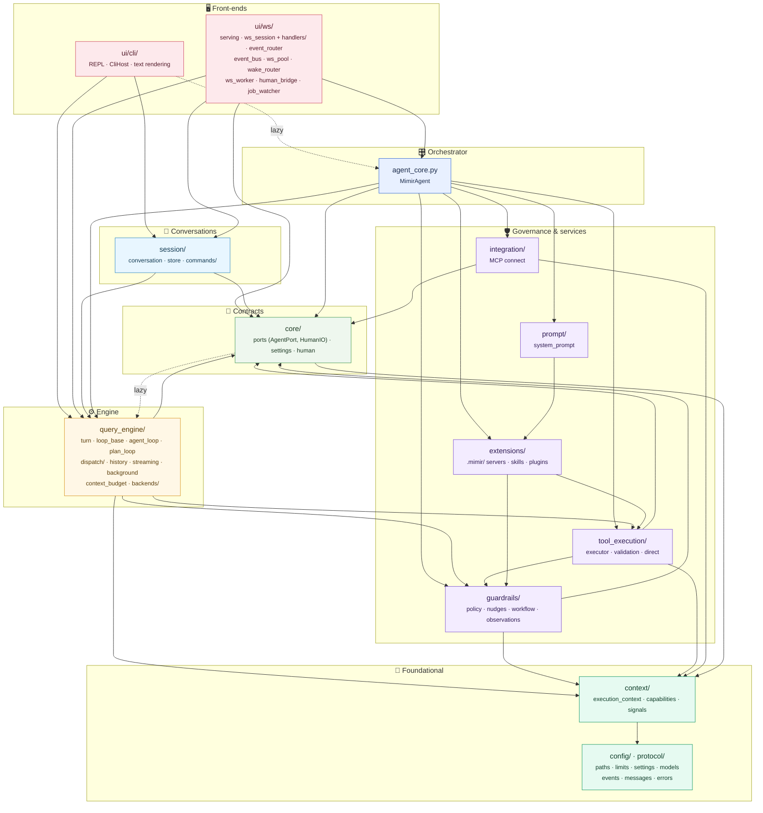

# MIMIR Architecture — Dependency Graph

> **MIMIR docs** — [Overview](README.md) · [Architecture](ARCHITECTURE.md) · [Setup](SETUP.md) · [Policy](POLICY.md) · [Client internals](CLIENT_DETAILED.md) · [Servers](SERVERS_DETAILED.md) · [Extension](EXTENSION_DETAILED.md) · [Plugins](PLUGINS_DETAILED.md)

The layering of `mimir/client/`, derived from the actual imports. Read top-to-bottom:
higher layers depend on lower ones. Solid edges are import-time; **dotted edges are
lazy** — imported inside a function, so they never run at load time.

The graph shows the layering, not every edge: every unit also imports the foundational
ones (`config`, `protocol`, `event_sink`, `human_pause`) and
`mimir/servers/_shared` freely, and those edges are omitted to keep it readable.

## How to read it

- **Foundational** (`config`, `protocol`, `context`, `event_sink`) depend on
  nothing above them. `config` is the vocabulary (paths, limits, the closed sets of each
  setting, the model catalogue); `protocol` the shapes that cross a boundary (event
  types, chat messages and their invariants, error payloads); `context` the
  `ExecutionContext` dataclass, the query/tool signals and the capability vocabulary;
  `event_sink` the injectable `emit()` seam that keeps the engine ignorant of front-ends.
- **`core`** holds the contracts the layers above agree on: `AgentPort` (everything the
  engine and the guardrails may call on an agent), `HumanIO` (how the agent reaches a
  person — the terminal, a WebSocket card, a sub-agent's caller, nobody), and the
  settings table (`apply_setting` / `read_setting`, one validation for every front-end).
- **`guardrails`** (hard `policy` gates as a pipeline, soft `nudges` as one cascade,
  the `workflow` state and the `observations` it records) sits below the engine.
- **`query_engine`** drives a turn: `turn.run_loops` switches between the `AgentLoop`
  and `PlanLoop` strategies (both `StepLoop`s), `dispatch/` admits and runs tool calls,
  `backends/` share one `LLMBackend.chat` template.
- **`agent_core.py`** (`MimirAgent`) is what every front-end, the runner and the
  sub-agent server instantiate; it implements `AgentPort`.
- **`session`** is what a conversation is, independent of the front-end showing it:
  `Conversation` (one in-memory object per conversation, handed to every writer by the
  `Conversations` registry), the `SessionStore` on disk, and the session commands
  (`Command`, `CommandRegistry`) both front-ends share.
- **`ui/`** is only the front-ends. The CLI drives an agent in-process; the WebSocket
  server runs one worker per conversation in a pool, whose pump commits answers and
  routes finished runs before any socket renders them.

### Back-edges

Two places where a lower unit reaches a higher one, each a **lazy import inside a
function**:

| Edge | Where | Why |
|---|---|---|
| `core → query_engine` | `core/settings._store_backend` | switching the backend needs the factory, and the engine reads the mode through `core.settings` at load |
| `ui/cli → agent_core` | `ui/cli/main.py` | the script-mode bootstrap (`python main.py`) has to fix `sys.path` first |

The proxy store (`guardrails/proxy_state`, `guardrails/policy/gates`) is lazy too: it
is the proxy server's heavy library, needed only by a conversation running an
optimisation. The WebSocket entry
(`ui/ws/ws_server.main`) imports `serving` only after applying `--cwd`, because
`config.paths` resolves the workspace root as it is imported.

### Cycles

None between units. `tool_execution` runs a call through the `guardrails` (policy
before, observations after), and nothing in `guardrails`, `core` or `context` imports
`tool_execution`: the path rules live in `context/paths.py` and the display vocabulary
in `context/tool_display.py`.

Everything else is a straight downward dependency.
