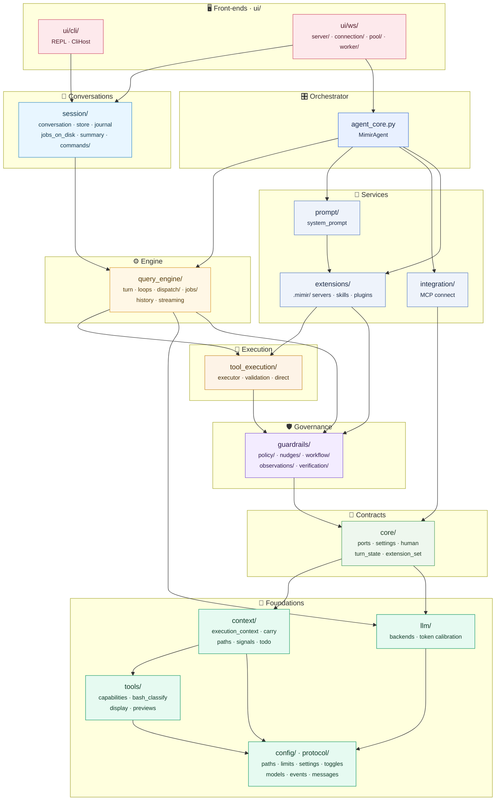

# MIMIR Architecture — Dependency Graph

> **MIMIR docs** — [Overview](README.md) · [Architecture](ARCHITECTURE.md) · [Setup](SETUP.md) · [Policy](POLICY.md) · [Client internals](CLIENT_DETAILED.md) · [Servers](SERVERS_DETAILED.md) · [Extension](EXTENSION_DETAILED.md) · [Plugins](PLUGINS_DETAILED.md)

The layering of `mimir/client/` and its relation to `mimir/servers/`. Every rule on
this page is checked by `mimir/tests/test_architecture.py`; a change that breaks one
fails the suite.

## The client's layers

Read bottom to top: a unit imports, at load time, only units below it. Every unit also
imports the foundations (`config`, `protocol`) and `mimir/shared`, the code the client and
the servers share; those edges are omitted.

| Rank | Units | What they are |
|---|---|---|
| 0 | `config`, `protocol` | the vocabulary (paths, limits, the closed sets of each setting, the models, the toggles), the shapes that cross a boundary (events, chat messages, error payloads), the `emit()` seam, the time spent waiting on a person |
| 1 | `tools`, `llm` | what each tool is (its capabilities, what a bash command does) and how a call reads on screen; the model backends and their token accounting |
| 2 | `context` | the `ExecutionContext` blackboard, the carry context, the path rules |
| 3 | `core` | the contracts the layers above agree on: the agent's ports, `HumanIO`, `TurnState`, `ExtensionSet`, the settings table |
| 4 | `guardrails` | hard `policy` gates, soft `nudges`, the `workflow` state, the `observations` that write the blackboard, the `verification` that establishes what is checked (the mandatory check, the repair ladder, the ledger) |
| 5 | `tool_execution` | a call run through the guardrails: policy before, observations after |
| 6 | `extensions`, `integration` | the user's `.mimir/` extensions; connecting MCP servers |
| 7 | `prompt` | the system prompt |
| 8 | `query_engine` | a turn: the loops, the dispatcher, detached jobs, the context budget |
| 9 | `agent_core` | `MimirAgent`, which every front-end, the runner and the sub-agent server instantiate; it satisfies `AgentPort` |
| 10 | `session` | a conversation, independent of the front-end showing it, and what it keeps on disk |
| 11 | `ui` | the front-ends: the CLI drives an agent in-process; the WebSocket server runs one worker per conversation in a pool |

No unit imports upwards. The WebSocket entry (`ui/ws/server/main.py`) imports
`serving` only after applying `--cwd`, because `config.paths` resolves the workspace
root as it is imported.

## The WebSocket front-end

`ui/ws/` is built from components. A component owns its state and is handed, at
construction, what it reads of the others (a value, or a function returning it); no
class there reads a `self.x` it does not define.

| Object | Components | What they do |
|---|---|---|
| `AgentWorker` (one per conversation) | `human` (`HumanBridge`), `jobs` (`JobWatcher`), `review`, `panel`, `usage` | the cards a turn parks on; the watchers of detached runs; diff review and revert; the drawer's sections; token usage. `worker.agent` is read-only |
| `AgentPool` | `bus` (`EventBus`), `writer` (`Writer`), `wakes` (`WakeRouter`), `lifecycle` (`Lifecycle`) | drains every worker and journals what it drained; commits a finished turn; hands a finished run's wake to its conversation; decides when the server may stop |
| `Connection` (one per socket) | `view` (`ViewState`), `out` (`Sender`), `screen` (`Screen`), and the handler groups `conversations`, `turns`, `cards`, `detach`, `panel` | the display state; the socket; the conversation on screen; one `on_<type>` method per inbound message |

`Connection.handle(message)` dispatches on the message type to the group whose
`MESSAGES` table names it.

## The execution context

What one query has established is an `ExecutionContext` of nine records, one per concern:
`discovery`, `edits`, `checks`, `execution`, `env`, `denials`, `plan`, `nudges` and
`bookkeeping`, with `workflow_state` and `action_op_count` on top. Every field declares its
default, its types and its traits; the derived lists (what is carried to the next query, what
a deleted file is purged from, what counts as discovery) are computed from the traits.

- **Who writes** each record is declared in the code (`execution_context.WRITERS`), and
  `test_architecture` holds every write to it.
- **Who only reads** takes a `ContextView` (`context/context_view.py`): the same object,
  typed read-only, so the type checker refuses a write through it, an alias included. The
  nudges, the workflow and the policy gates take it; the few functions there that write
  their own state (a nudge's count, the skill gate's reservation, the workflow state) take
  the `ExecutionContext`, which says so in their signature.
- Not covered: the order of a step, a read of a field before the step that fills it.

## The guardrails

`guardrails/` reads the context and never runs a tool. `policy/` blocks a call before it runs;
`nudges/` reminds the model when it stops calling tools, verification rows first, then
guidance rows gated by the enforcement level; mid-loop correctives speak after a dispatch
step. Which rows exist and at which level is POLICY.md's table; `/diag nudges` counts what
actually fires.

## Detached runs

A run that outlives its tool call is described the same way everywhere, by
`shared/jobs.py`: the descriptor a watcher polls, the payload keys that carry it
(`background_job` launched, `background_jobs` handed over), the terminal words and the files
a run's directory holds. The servers produce descriptors through it; the client's watcher, its
disk scan and the dispatch guards read them through it. Slurm's states are read into those
words by `shared/slurm_site`, which only the servers load.

## The VS Code extension

The extension host (`src/`) and the webview (`webview/src/`) share `src/shared/` (the
endpoint defaults and the `HostMessage` union of what the webview asks of the host). The
webview's state lives in hooks by concern (`useEndpoint`, `useAgentSettings`, `usePanels`,
`useComposer`) and the chat reducer; each hook answers the server messages about its state
through a handler table. Both halves are type-checked by `npm test`.

## What the client and the servers share

`mimir/shared/` imports neither the client nor the servers; both import it. It serves two
readers:

| Reader | Modules |
|---|---|
| **The client and the servers**: the contract between them, and what both run | `state_paths` (the on-disk layout), `exec_seals` (the files a server seals for a conversation, which the guardrails refuse to run directly), `jobs` (the run contract), `run_channel` (the divert channel), `capabilities` (the vocabulary a server declares with), `responses` (the shape of a tool answer), `shell_paths`, `trusted_read_roots`, `extension_paths`, `skill_file`, `launcher`, `atomic`, `processes`, `embed` |
| **The servers only**: what two domains or more share | `slurm_site`, `slurm_script`, `shell_activity`, `cpu_facts`, `build_progress`, `approved_roots`, `module_env`, `clock` |

## The servers

`mimir/servers/` is a package: each domain (`workspace`, `agent_state`, `hpc`, `proxy`,
…) imports `mimir.shared` and its siblings by package. A bundled server runs as a module
through `servers/_launch.py` (`shared/launcher.launch_argv`), which keeps the user's
workspace off `sys.path`; a server of `.mimir/servers/` still starts by its path.

- `shared` holds what two domains or more use, or what the client reads too; a module one
  domain uses lives in its package (`hpc/slurm_digest`, `workspace/lsp_client`,
  `agent_state/model_catalog`).
- Only `agent_state` (the sub-agent server builds a `MimirAgent`) and `interaction`
  import the client, and only its public names.
- The client imports no server: what it reads of a server's files is a contract in
  `shared`.

## Rules for every module

- **One home per concept.** The on-disk layout (`shared/state_paths`), the atomic write
  (`shared/atomic`), the shape of a tool answer (`shared/responses`), the clock, the
  pid liveness check, the SKILL.md format: each has one module.
- **No private name crosses a module.** A name another module imports or reads off a
  module (`store.read_json`) is public, in the client and the servers alike.
- **Comments say what the code does now.** History belongs in the commits and
  [CHANGELOG.md](CHANGELOG.md).
- **Docstrings are short.** A function's says what it does in a line, plus at most a
  few lines of why (6 in all); a module's says what it holds (8 in all). The longer
  reasoning lives in the `*_DETAILED.md` docs. An MCP tool's docstring is exempt: it is
  what the model reads. The same holds for tests and for the extension's comments.
- **Types are checked.** `mypy` covers `mimir/client`, `mimir/servers` and `mimir/shared`; `core`,
  `context` and `config` are held to fully typed definitions. `MimirAgent` is checked
  against `AgentPort` statically.
- **A layer gets the port of its need.** `core/ports.py` holds small bricks (the tool
  registry, the workspace paths, running a tool, the approvals, the settings, the turn,
  the MCP connections), composed per layer: the nudges get a `NudgeAgent`, the
  observations an `ObserverAgent`, the policy a `PolicyAgent`, the executor an
  `ExecutorAgent`, the server connection a `ConnectorAgent`. `AgentPort`, every brick, is
  the engine's. mypy refuses a layer reaching past its port, and `test_architecture`
  refuses a `getattr(agent, "…")` around it and a member no layer reads.
- **Tests go through public construction and behaviour.** No test reads the source or
  builds an object around its constructor; shared fixtures live in `mimir/tests/support/`.
  The architecture leads and the tests follow it: a test that pins an old internal is
  rewritten on the behaviour, not kept by bending the code.
