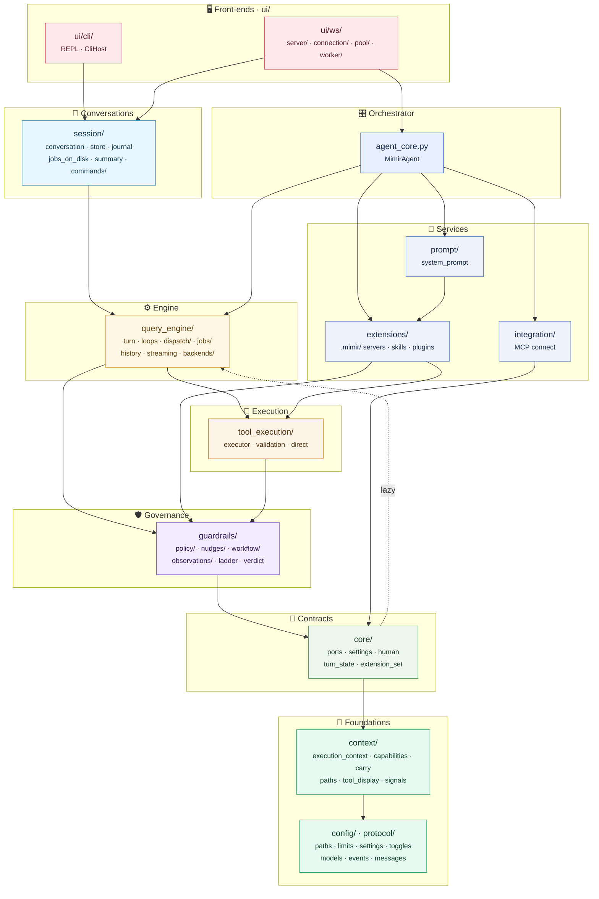

# MIMIR Architecture — Dependency Graph

> **MIMIR docs** — [Overview](README.md) · [Architecture](ARCHITECTURE.md) · [Setup](SETUP.md) · [Policy](POLICY.md) · [Client internals](CLIENT_DETAILED.md) · [Servers](SERVERS_DETAILED.md) · [Extension](EXTENSION_DETAILED.md) · [Plugins](PLUGINS_DETAILED.md)

The layering of `mimir/client/` and its relation to `mimir/servers/`. Every rule on
this page is checked by `mimir/tests/test_architecture.py`; a change that breaks one
fails the suite.

## The client's layers

Read bottom to top: a unit imports, at load time, only units below it. Solid edges are
import-time; the **dotted edge is lazy** (imported inside a function). Every unit also
imports the foundations (`config`, `protocol`, `event_sink`, `human_pause`) and
`mimir/servers/_shared`; those edges are omitted.

| Rank | Units | What they are |
|---|---|---|
| 0 | `config`, `protocol`, `event_sink`, `human_pause` | the vocabulary (paths, limits, the closed sets of each setting, the models, the toggles), the shapes that cross a boundary (events, chat messages, error payloads), the `emit()` seam |
| 1 | `context` | the `ExecutionContext` blackboard, the capability vocabulary, the carry context, the path rules, how a call reads on screen |
| 2 | `core` | the contracts the layers above agree on: `AgentPort`, `HumanIO`, `TurnState`, `ExtensionSet`, the settings table |
| 3 | `guardrails` | hard `policy` gates, soft `nudges`, the `workflow` state, the `observations` that write the blackboard, the repair `ladder` |
| 4 | `tool_execution` | a call run through the guardrails: policy before, observations after |
| 5 | `extensions`, `integration` | the user's `.mimir/` extensions; connecting MCP servers |
| 6 | `prompt` | the system prompt |
| 7 | `query_engine` | a turn: the loops, the dispatcher, detached jobs, the context budget, the backends |
| 8 | `agent_core` | `MimirAgent`, which every front-end, the runner and the sub-agent server instantiate; it satisfies `AgentPort` |
| 9 | `session` | a conversation, independent of the front-end showing it, and what it keeps on disk |
| 10 | `ui` | the front-ends: the CLI drives an agent in-process; the WebSocket server runs one worker per conversation in a pool |

The one lazy back-edge: `core.settings` reaches the backend factory in `query_engine`
when the backend is switched, because the engine reads the mode through
`core.settings` at load. The WebSocket entry (`ui/ws/server/main.py`) imports
`serving` only after applying `--cwd`, because `config.paths` resolves the workspace
root as it is imported.

## The servers

`mimir/servers/` is a package: each domain (`workspace`, `agent_state`, `hpc`, `proxy`,
…) imports `_shared` and its siblings by package. A bundled server runs as a module
through `servers/_launch.py` (`_shared/launcher.launch_argv`), which keeps the user's
workspace off `sys.path`; a server of `.mimir/servers/` still starts by its path.

- `_shared` never imports the client.
- Only `agent_state` (the sub-agent server builds a `MimirAgent`) and `interaction`
  import the client, and only its public names.

## Rules for every module

- **One home per concept.** The on-disk layout (`_shared/state_paths`), the atomic write
  (`_shared/atomic`), the shape of a tool answer (`_shared/responses`), the clock, the
  pid liveness check, the SKILL.md format: each has one module.
- **No private name crosses a module.** A name another module imports is public; a
  server's private packages (the proxy's `_lib`, `_ops`) are internal to that server.
- **Comments say what the code does now.** History belongs in the commits and
  [CHANGELOG.md](CHANGELOG.md).
- **Tests go through public construction and behaviour.** No test reads the source or
  builds an object around its constructor; shared fixtures live in `mimir/tests/support/`.
